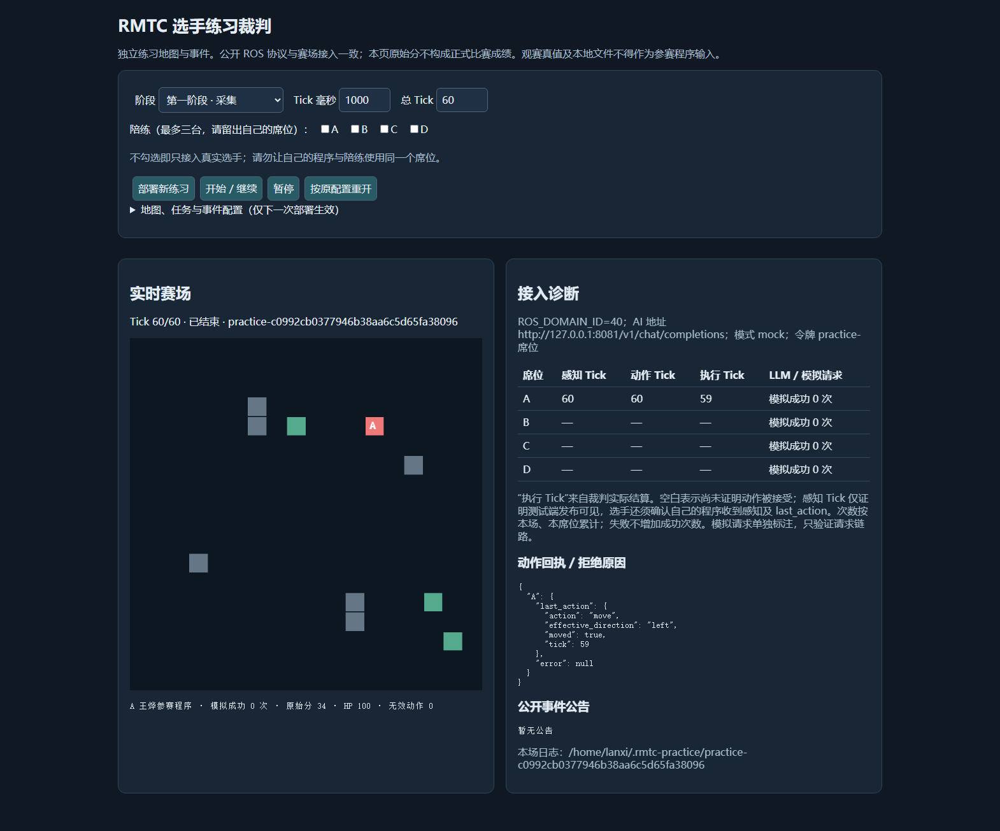

# RMTC 图灵对决赛参赛程序

> 封存候选版本：2026-10-30（参赛手册核对修订）；作者：王烨；队内分工：单人负责设计、实现、测试和材料整理，在 AI 辅助下完成；AI 辅助范围和人工确认责任见 `TECHNICAL_REPORT.md`。

## 目录

- `rmtc_contestant/`：可执行的 ROS 2 Humble Python 包。
- `TECHNICAL_REPORT.md`：技术报告入口。
- `SUBMISSION_CHECKLIST.md`：递交与现场检录核对表入口。
- `EVIDENCE_MANIFEST.md`：练习证据及其证明范围入口。

## Ubuntu 22.04 / ROS 2 Humble 构建

```bash
cd /path/to/rmtc-contestant/rmtc_contestant
source /opt/ros/humble/setup.bash
python3 -B -m unittest discover -s test -v
cd ..
colcon build --packages-select rmtc_contestant
```

## 第一阶段启动

```bash
cd /path/to/rmtc-contestant/rmtc_contestant
export ROS_DOMAIN_ID='主办方本场公布值'
export RMW_IMPLEMENTATION=rmw_fastrtps_cpp
export ROS_LOCALHOST_ONLY=0
export TEAM=A
export TEAM_NAME='本队正式队名'
export RMTC_STAGE=1
bash scripts/run_contestant.sh
```

## 第二阶段启动

第二阶段必须使用主办方分配的本场席位、真实 `AI_GATEWAY`、`AI_MODEL`，并交互式输入本场 `RMTC_TEAM_TOKEN`：

```bash
cd /path/to/rmtc-contestant/rmtc_contestant
export ROS_DOMAIN_ID='主办方本场公布值'
export RMW_IMPLEMENTATION=rmw_fastrtps_cpp
export ROS_LOCALHOST_ONLY=0
export TEAM='主办方分配的本场席位'
export TEAM_NAME='本队正式队名'
export RMTC_STAGE=2
export AI_GATEWAY='主办方提供的真实统一 AI 服务地址'
export AI_MODEL='deepseek-flash' # 手册指定；如有更新按主办方通知
read -rsp '本场本席位 AI 令牌: ' RMTC_TEAM_TOKEN; echo
export RMTC_TEAM_TOKEN
bash scripts/run_contestant.sh
```

`AI_GATEWAY`、`AI_MODEL` 和 `RMTC_TEAM_TOKEN` 不随本项目提供。练习端 mock 记录和本项目测试结果只能说明相应练习或回归范围，不能称为正式 AI 资格或现场检录通过。

## 封存与人工策略切换边界

当前封存候选只使用内置确定性策略；程序未实现、未登记任何人工 `decision_type`，也不提供 `decision_config.json`。不得在现场新建或修改该文件，也不得使用坐标、目标、动作、Prompt 或其他参数实施人工控制。未来若要支持人工策略切换，必须在新的赛前封存版本中实现、测试、登记读取方式并获裁判批准。

## 现有练习证据与明确边界

- Stage 1 一次练习结果：资源价值 200、采集分 40/40、非法动作 0。
- Stage 2 mock 一次练习结果：得分 31.4、任务 2/3、非法动作 0。
- 已有进程重启恢复和跨 session 状态隔离的练习证据。
- 2026-10-31 已新增公开 Stage 1 裁判页面截图及本队节点日志：60 Tick 慢速诊断练习，资源 170、练习分 34、非法动作 0。截图证明裁判侧执行回执；日志含程序侧 position、当前 tick/session_id 动作及后续 receipt。完整编译启动及双向链路连续影像仍需补齐，正式检录以主办方确认为准。



请结合 [`DEMO_GUIDE.md`](DEMO_GUIDE.md) 执行演示，并以 `TECHNICAL_REPORT.md`、`SUBMISSION_CHECKLIST.md` 与 `EVIDENCE_MANIFEST.md` 中的后续材料为准。
