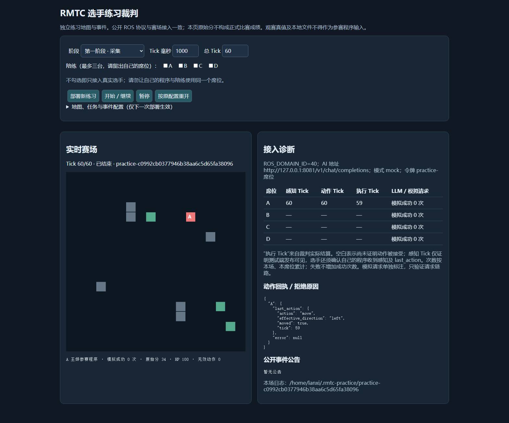

# RMTC 图灵对决赛技术报告

> **版本说明：**规则 v1.2 为主要规则基准；2026-10-31 收到的规则/协议 v1.1 与教程 v1.1 用于交叉核对，不能据此覆盖后发版本，最终以主办方当前公告为准。

> **事实基准与范围：**本报告依据 2026-10-26 留存的测试记录、项目源码及官方规则 v1.2 编写；只陈述已有代码和练习证据，不把练习结果写成正式比赛成绩、真实 LLM 理解结果、正式 AI 资格或现场检录结论。

## 1. 报告依据与人员分工

- **作者：**王烨
- **参赛标识：**公开版本不列学号；按主办方要求在私下递交时填写。
- **人员与分工：**无其他队员。王烨是单人参赛者与最终责任人，在 AI 辅助下负责规则整理、方案确认、协议与策略实现、测试与 Ubuntu ROS 2 接入核验、官方练习裁判联调及材料整理。
- **代码封存候选基准：**2026-10-30 手册核对修订；五份练习证据仍为历史记录。10 月 30 日修正 AI 输出上限；10 月 31 日另完成新版公开测试包的构建和 Stage 1 链路诊断，见第 7 节。
- **已记录环境：**Windows Python 3.9.13；Ubuntu 22.04、ROS 2 Humble、`rmw_fastrtps_cpp`。

官方规则 v1.2 第 191–199 行要求技术报告包含整体设计、功能完成情况与方式、队内分工、日程、问题与解决、AI 协同开发、测试截图、运行逻辑与指令，并以语雀文档形式提交。第 239–245 行要求在赛前完成感知接收、合法动作提交、当前 `tick` 与 `session_id` 回填及联调验证；第 302–314 行同时明确公开测试裁判和练习结果不能替代正式赛场条件、真实 AI 调用检查或现场检录。

## 2. 日程与可核验产出

本节不估算工时，也不补写无记录支撑的具体活动日期。下表以 `development-test-record.md` 中标为 **2026-10-26** 的记录为基准；其中第 15、16、17 轮构成已有的联调阶段证据。

| 开发阶段 | 可核验产出与范围 |
|---|---|
| 规则与协议整理 | 以官方 `rules_v1.2.txt`、`CONTESTANT_PROTOCOL.md` 为准，核对本队公开话题、当前帧 `tick/session_id` 回填、Stage 1 席位与动作限制、Stage 2 的 AI 边界。 |
| 程序设计与实现 | 形成 `ament_python` ROS 2 包 `rmtc_contestant`：入口为 `contestant = rmtc_contestant.node:main`，运行依赖为 `rclpy`、`std_msgs`。 |
| 回归测试阶段 | 测试记录记载 Windows Python 3.9.13 与 Ubuntu 系统 Python 各有 82 项 `unittest` 通过；Ubuntu 上曾完成一次 `colcon build`，输出为 `1 package finished`。这些是历史记录；10 月 31 日独立验证见 DELIVERY_VERIFICATION。 |
| 第 15 轮联调 | 自研节点以 A 席位接入官方 Stage 1 练习裁判，保存练习结算快照、节点动作日志及执行回执。 |
| 第 16 轮联调 | 完成一次 500 Tick Stage 2 **mock** 练习、基础攻击回执验证，以及同场进程重启后的晚加入、阵亡等待和复活恢复观察。 |
| 第 17 轮联调 | 在同一个参赛进程中连续运行两场 Stage 1，保存跨 `session_id` 的动作与感知对齐日志。 |
| 10 月 30–31 日材料整理 | 手册核对；新版公开练习包构建、Ubuntu 单测；10 月 31 日运行本队 Stage 1 并采集裁判页截图与原始日志。完整连续检录影像及语雀上传仍待完成。 |

## 3. 整体设计与运行架构

### 3.1 包结构与职责

`rmtc_contestant` 是 ROS 2 Humble 的 Python 包，采用“协议—状态—规划—策略—控制器—ROS 适配器”分层：

1. **协议层 `protocol.py`**：解析本队感知 JSON，校验非负整数 `tick` 与非空字符串 `session_id`；序列化 `move`、`attack`、`defend`、`wait` 四类合法动作。`move/attack` 必须带四向方向，`defend/wait` 不带方向。动作 JSON 从当前感知原样取回 `tick` 与 `session_id`。
2. **几何与状态层 `geometry.py`、`state.py`**：将官方 9×9 相对位置字符串（九行之间有换行）解码为相对坐标，再用当前公开 `self.position` 还原可见实体绝对坐标。`WorldState` 只接纳校验通过的本队公开感知；它维护当前可见资源、已观测障碍、当帧敌车、任务、分数和访问记录。
3. **规划层 `planner.py`**：使用固定四方向顺序的 BFS 生成可复现的最短路径；阻塞集合来自已观测障碍、当前可见敌车和已确认的临时风险，而不是全图真值。
4. **策略层 `strategy.py`**：根据当前公开状态选择资源、任务、探索、避险、攻击或防御动作。策略每帧重规划，不通过网页、观赛全图、裁判内部文件、其他席位私有感知或人工转述获得输入。
5. **控制器与 ROS 层 `node.py`**：处理重复/陈旧帧、场次重置、动作安全兜底、执行回执日志及可选 AI 请求。只有 `main()` 导入 ROS；因此协议、状态、规划和策略可以在不启动 ROS 的情况下单元测试。
6. **可选 AI 层 `ai_client.py`**：只有在 Stage 2 且 `AI_GATEWAY`、`RMTC_TEAM_TOKEN`、`AI_MODEL` 均已配置时，运行时才创建 `AiClient` 实例。它使用后台线程发起非阻塞 HTTP 请求，严格校验结构化事件输出；未配置、网络失败、超时、排队已满或响应非法时，确定性策略继续运行。

### 3.2 公开 ROS 话题与输入边界

官方协议规定公开话题的 ROS 消息类型均为 `std_msgs/msg/String`。程序按本场席位 `X` 使用以下话题；`X` 不被程序自行越权更改。

| 话题 | 本程序方向 | 实际用途与边界 |
|---|---|---|
| `/team_X/perception` | 订阅 | 本队当前公开感知 JSON，是控制器、状态更新和动作决策的权威输入。当前 `tick`、`session_id`、`self.position`、可见实体、`missions`、本队公开 `score`、`event_text` 与 `mission_text` 均从该帧读取。 |
| `/team_X/action` | 发布 | 每个新帧至多构造一个与该帧同值的 `tick/session_id` 动作 JSON；后续感知中的 `last_action`/回执只用于核对上一 Tick 的结果。 |
| `/team_X/registration` | 发布 | 发布本场席位和显示队名的注册 JSON；注册发布者保持存活以便裁判发现。 |
| `/referee/event_text` | 订阅 | 保持公开接口订阅兼容，但原始锁存文本不直接作为策略或 AI 的权威输入；`handle_event()` 不将其写入决策状态。当前感知中的 `event_text` 才会在 Stage 2 交给 `AiClient`。 |
| `/referee/mission` | 订阅 | 保持公开接口订阅兼容；任务决策读取当前感知中的 `missions` 和 `mission_text`，不把锁存话题文本当作跨场次状态。 |
| `/referee/team_registry` | 订阅 | 仅为公开名录接口兼容，不作为路径、攻击或资源策略输入。 |

代码为感知/动作使用深度 1 的可靠、易失 QoS；注册使用深度 1 的可靠、`TRANSIENT_LOCAL` QoS；事件公告订阅使用深度 128 的可靠、`TRANSIENT_LOCAL` QoS。上述订阅不等于获得观赛、裁判管理或其他席位数据的权限。官方协议明确禁止把全图观赛、练习配置编辑、网页诊断或其他席位专属感知作为参赛策略输入；本程序不读取这些数据。

### 3.3 Tick、session、重复帧与陈旧帧

运行时主链路如下：

1. 收到 `/team_X/perception` 后解析 JSON，拒绝结构错误、缺少身份字段或类型错误的感知。
2. 在同一 `session_id` 内，较小 `tick` 记为 stale 并丢弃；相同 `tick` 不重复推进状态或策略，而是重发缓存动作；这避免重复帧导致重复计数或重复规划。
3. 收到新的 `session_id` 时，控制器清空动作缓存、已提交 AI 文本和当前策略实例的场次状态；旧场次被记为 retired，进程运行期间不再重新接纳。
4. 对合法的新感知，`WorldState` 原子更新；控制器先轮询已完成的异步 AI 结果，再做确定性决策，执行安全检查，构造当前帧动作并记录不含令牌的摘要日志。
5. 动作确定后才尝试可选的异步 AI 提交；AI 的等待、异常或失败不会阻塞 ROS 感知回调，更不会阻止当前帧动作。

这与规则“只处理最新 Tick、相同 Tick 可重发缓存动作、换场清空缓存”的要求一致。当前坐标始终来自当前公开 `self.position`；程序不从旧动作、网页动画或推测轨迹累计位置。

### 3.4 Stage 1 与 Stage 2 策略边界

**Stage 1：**规则规定第一阶段仅使用 A 席位，动作 Tick 范围为 0–99，最终状态为 `tick=100`。控制器在 `RMTC_STAGE=1` 时会将 `attack` 与 `defend` 降级为 `wait`，且不提交 AI 请求。策略在 100 Tick 预算内，以可见资源价值/路径长度为优先级，并使用 BFS 探索未覆盖的公开视野区域。

**Stage 2：**规则规定第二阶段动作 Tick 范围为 0–499，最终状态为 `tick=500`。策略将路径预算设为 500 Tick，并从当前公开 `missions` 处理官方结构化任务类型：`normal_resources`、`high_resources`、`resource_value`、`effective_damage`、`reach`；已出现在 `score.mission_completed_ids` 中的任务不再重复追逐。策略随后在公开可见敌车附近执行基础攻击、低血量退避或防御，并以公开资源和探索作为后备选择。

对于已被合法 AI 结构化确认的事件，当前策略实现了爆炸区域规避、未知幻术区域的保守不进入、`world_split` 临时墙的私有阻塞视图，以及 `purity` 期间不攻击当前感知中正在防御的敌车。事件的有效区间按 `[start_tick, end_tick)` 处理：生效 Tick 包含、`end_tick` 不包含。该策略不是完整事件规则解释器，未实现的能力在“已知缺口”中单列。

### 3.5 自然语言事件与 AiClient 的安全降级

随机事件自然语言不在本地通过关键词、模板或人工规则直接转成动作。只有在 Stage 2 运行时真正启用 `AiClient` 且配置 `AI_GATEWAY`、`AI_MODEL`、`RMTC_TEAM_TOKEN` 时，当前感知的完整 `event_text`（首帧无事件文本时可提交 `mission_text`）才会作为异步结构化请求上下文，并同时提交当前场次、提交 Tick、地图尺寸和本车位置。正式场的三项配置必须使用主办方提供的真实统一 AI 服务、本场模型和本场本席位令牌；本次只有 mock 配置实测。请求去重基于完整文本与任务文本，不能把被换行切分的公告误当成不同或不完整事件。

`AiClient` 的系统约束要求返回且仅返回 `{"events":[...]}`。每个事件需经以下校验后才可能进入策略：事件 ID、允许的事件种类、绝对 `start_tick/end_tick`、有界整数坐标、矩形端点顺序、有限非负数值与允许的 effect 字段；未知事实应为 `null` 或省略整个无法确定的事件。控制器还会再次核验结果的场次、提交 Tick 不晚于当前 Tick、状态和坐标范围。

非阻塞与降级边界如下：

- 直接以 `python3 -m rmtc_contestant.node` 启动时，若未设置真实网关/模型/本场令牌，`node.py` 会禁用 AI 并继续运行确定性策略；但交付脚本 `scripts/run_contestant.sh` 在 `RMTC_STAGE=2` 时严格要求三项变量齐全，缺少任一项即在启动节点前退出；
- HTTP、鉴权、限额、网络、超时或非法 schema 响应不会将模型文本变成动作；
- 不同 `session_id`、未来 Tick、过期或非法的异步结果被丢弃；
- HTTP 成功计数只表示一次 HTTP 成功接收，不等于输出 schema 正确、事件理解正确、策略正确或正式资格成立。

## 4. 功能完成情况与已有练习结算

### 4.1 练习结果总表

| 项目 | 实现方式 | 已有练习证据 | 结论边界 |
|---|---|---|---|
| Stage 1 独立采集 | 公开可见资源的 BFS、探索与当前帧动作身份回填；Stage 1 禁止攻击/防御/AI 请求。 | 归档证据 `evidence/stage1-self-developed-r15.json`：场次 `practice-9f1e7f9ebeb7430aa8efde78996654e7` 最终 `tick=100`、`executed_tick=99`、资源价值 **200**、采集分 **40/40**、`invalid_actions=0`、HP **100**。 | 这是一次练习场次结果，不是正式成绩，也不代表任意正式地图上的满分或性能保证。 |
| Stage 2 资源、任务与基础对抗 | 500 Tick 路径预算；官方结构化任务优先；公开敌车基础攻击、低血量避险/防御；任务完成状态读取当前公开感知。 | 归档证据 `evidence/stage2-final-r16.json`：**mock** 场次 `practice-aea08d765b5d40aa886243b99f22a12e` 共 500 Tick，自研 A 得分 **31.4**、资源 **40**、`effective_damage=380`、任务 **2/3**、`invalid_actions=0`、HP **100**、四队中 **第 4/4**；最终动作执行 Tick 为 499。 | 该结果是练习 mock 结算，不是正式比赛成绩；第 4/4 表明此练习中排名落后，不能宣称竞争优势。 |
| Stage 2 mock AI 链路 | `AiClient` 后台 HTTP、严格 schema 验证、跨场次过滤和确定性降级。 | 归档证据 `evidence/development-test-record.md` 记录同一 Stage 2 练习中 A 的 mock HTTP 成功次数为 **31**。 | 这 31 次只表示 mock 传输成功；不等于真实 LLM 事件理解、schema 解析成功、真实统一 AI 成功记录或正式 AI 资格。 |
| 同场重启恢复 | 进程新启动后从当前公开感知重新定位；死亡帧安全 `wait`；复活后按当前帧继续决策。 | 归档证据 `evidence/development-test-record.md` 与 `evidence/stage2-after-restart-final-r16.log`：同一 Stage 2 场次在 `tick=141` 暂停，旧自研进程 SIGINT 后正常退出；新进程在 `tick=142` 接入同一 `session_id`，阵亡帧提交 `wait`；`tick=143` 从公开重生坐标 `[1,1]` 移动，`tick=144` 回执确认该移动成功。 | 证明该次练习中的真实进程重启、晚加入定位、死亡等待和复活恢复；不推导正式比赛允许的重启次数或现场网络可靠性。 |
| 同进程跨场次隔离 | 新 `session_id` 清空策略、动作和 AI 文本状态，旧场次不重新接纳。 | 归档证据 `evidence/cross-session-r17.log` 记录同一进程连续运行两个 Stage 1 场次：`practice-fae9b1faa3744de7889d5565ecff97f9` 与 `practice-a8e4b05b172c4876bc0360d405f5e113`。每场均记录 `tick=0..100` 共 **101 帧**，逐条检查的动作 `tick/session_id` 与本帧感知一致，未沿用上一场身份。 | 这是练习中的 session 隔离证据，不能替代本场正式席位、网络或 AI 检录。 |

### 4.2 测试记录的正确表述

- 归档证据 `evidence/development-test-record.md` 第 15 轮记录：Windows Python 3.9.13 的 82 项 `unittest` 全部通过；Ubuntu 系统 Python 的同 82 项也全部通过。
- 同一归档证据记录 Ubuntu 上曾独立执行 `colcon build`，结果为 `1 package finished`。
- 这些结论均为 **2026-10-26 留存记录**。历史结果与 2026-10-31 新验证分开记录；本次 Ubuntu 82 项测试及 colcon 构建输出见 DELIVERY_VERIFICATION。

## 5. 已遇到的问题与当前对应处理

下表只列出源码和测试中可对应的处理，不补写未记录的故障经过或人为归因。

| 问题/规则细节 | 当前代码处理 | 对应测试或代码证据 |
|---|---|---|
| 官方 `visible_entities[].position` 是带换行的 9×9 相对位置字符串，不能直接当作绝对坐标数组。 | `decode_relative_grid()` 对字符串使用 `split('\n')`，验证九行、中心标记和相对目标，再以当前公开 `self.position` 还原绝对坐标。 | `geometry.py`；`test_geometry.py` 的 `test_accepts_protocol_newline_string`；`test_state.py` 的公开 JSON 位置字符串用例。 |
| AI 成功计数可能是整数 `1`，不能仅接受布尔值。 | 策略只在 `status='ok'` 且 `http_success` 为 `True` 或正整数时接受结果；但仍要求事件结构合法且场次/Tick 可用。 | `strategy.py`；`test_strategy.py` 的 `test_real_ai_success_count_is_accepted`；`test_node.py` 的 `http_success: 1` 用例。 |
| Stage 2 不是 Stage 1 的 100 Tick 时域。 | 策略按 `stage` 选择 100 或 500 Tick 路径预算，Stage 2 在 Tick 100 后仍可选取可达目标。 | `strategy.py`；`test_strategy.py` 的 `test_stage2_keeps_five_hundred_tick_budget`。 |
| 官方任务类型应从结构化 `missions` 读取，不以自然语言猜测计分目标。 | 支持 `normal_resources`、`high_resources`、`resource_value`、`effective_damage`、`reach`；通过 `mission_completed_ids` 忽略已完成任务。 | `strategy.py` 的 `_mission_path()` 与 `_damage_mission_due()`；`test_strategy.py` 的官方资源任务优先用例。 |
| 事件 `end_tick` 是排他边界。 | 活跃判定使用 `start_tick <= tick < end_tick`，到达 `end_tick` 即从策略临时事件视图中过期。 | `strategy.py`；`test_strategy.py` 的 `test_event_end_tick_is_exclusive`；规则 v1.2 第 557 行。 |
| 临时墙到期时不能误删除静态障碍。 | `world_split` 墙只加入策略私有的临时阻塞视图；过期时只去除临时墙，`WorldState.obstacles` 中已经观测的静态障碍保留。 | `strategy.py`；`test_strategy.py` 的临时墙过期和静态障碍保留两个用例。 |

## 6. AI 协同开发的实际边界

AI 协同实际用于规则梳理、实现代码与测试代码生成、工具命令执行、练习环境联调及文档整理。王烨是本项目的单人参赛者与最终责任人，负责审阅和确认 AI 生成或执行的结果，对接口、改动、测试记录、联调结论和提交材料承担责任；不将 AI 工具虚构为队员、人工协作者或独立参赛主体。

已有 Stage 2 实测只使用 mock 链路；没有在这些记录中调用真实赛场 LLM。不得把 AI 辅助开发、mock HTTP 成功次数或 `AiClient` 源码接口表述为模型理解成功、真实统一 AI 成功记录或正式资格。

## 7. 测试截图、录屏与现场检录待办

2026-10-30 手册核对更正：赛前前置检录可在公开测试端用本队程序完成，需将完整双向链路截图放进技术报告，截止 2026-10-31 20:00。它不要求先取得正式比赛网络/令牌。比赛当天的正式接入和每场真实 AI 成功资格另外核验；下述历史材料缺口不能被误读为必须等到现场才能拍摄赛前截图。

此次 AI 请求补充 `max_tokens=512`，正式模型按手册配置为 `deepseek-flash`。完整有线/VMware 桥接步骤见 DEMO_GUIDE；IP、域和 HTTP 地址均按实际分配，不照抄示例。

规则 v1.2 第 239–241 行及 2026-10-31 测试教程 v1.1 要求用本队程序完成编译启动、接收本队感知、回填正确 `tick/session_id`、提交合法动作并核对后续执行回执，截图或录屏须于 **2026 年 10 月 31 日 20:00 前**随其他材料递交。本文附本队 Stage 1 公开测试裁判页截图；图中显示裁判发布感知、接收动作及执行回执。程序侧 position、同 tick/session_id 动作及后续 receipt 见同场原始日志。尚未取得含编译启动与上述全部字段的连续影像，不能将本图单独认定为合格前置检录或正式成绩。

`stage1-self-developed-r15.json`、Stage 2 JSON、节点日志和跨场次日志是机器可读的练习证据：它们可用于说明一次练习的结算、动作回执或会话对齐，但**不能替代**规则要求的图片/视频，也不能替代现场真实 AI、指定设备、指定有线网络和本场席位的检录。

以下清单中的**截图/录屏必须在规定截止前采集并随材料递交**；不得理解为可以仅等到比赛现场再补交。比赛现场还须按主办方通知，在指定设备、网络、席位与服务条件下完成相应核验。



图 1：公开练习裁判页面（浏览器原页直接截图）。本场 session 为 `practice-c0992cb0377946b38aa6c5d65fa38096`，感知 Tick 60、动作 Tick 60、执行 Tick 59，回执为向左移动成功。配置为 1000 ms/Tick、60 Tick，仅作慢速链路诊断，不可与标准 100 Tick 练习成绩直接比较。练习资源 170、分数 34、非法动作 0。
- [x] 已采集裁判页面截图，原始节点日志为 `docs/precheck-node-2026-10-31.log`，状态摘录为 `docs/precheck-state-2026-10-31.json`。
- [ ] 补齐含编译启动、程序侧当前 position / tick / session_id、同值动作和后续回执的连续截图或录屏，并于截止前上传语雀及递交；尚未确认上传或主办方收件。
- [ ] Stage 2 使用主办方提供的真实统一 AI 网关、模型和本场本席位令牌，保留不含令牌的本场成功记录。
- [ ] 由裁判确认后再更新现场检录状态；在此之前不得写为已完成正式检录。

## 8. 运行逻辑与 Ubuntu ROS 2 Humble 命令

以下命令使用可迁移的项目占位路径，不硬编码此前虚拟机中的临时工作路径。开始前应将 `/path/to/rmtc-contestant` 替换为封存版本所在目录；主办方发放的 ROS 域、席位、网关、模型和令牌也必须按本场通知替换。

### 8.1 构建与单元测试

```bash
cd /path/to/rmtc-contestant/rmtc_contestant
source /opt/ros/humble/setup.bash
python3 -B -m unittest discover -s test -v
cd ..
command -v colcon >/dev/null 2>&1 || export PATH="$HOME/.local/bin:$PATH"
colcon build --packages-select rmtc_contestant
```

运行逻辑为：构建完成后，`scripts/run_contestant.sh` 会加载 ROS 2 环境；若项目上层已有 `install/setup.bash`，脚本会加载该工作空间环境，然后以 `python3 -m rmtc_contestant.node` 启动节点。只有重新执行上述命令并阅读输出，才可对当前副本作出新的测试或构建结论。

### 8.2 Stage 1 启动（仅 A 席位）

```bash
cd /path/to/rmtc-contestant/rmtc_contestant
source /opt/ros/humble/setup.bash
export ROS_DOMAIN_ID='主办方本场公布值'
export RMW_IMPLEMENTATION=rmw_fastrtps_cpp
export ROS_LOCALHOST_ONLY=0
export TEAM=A
export TEAM_NAME='本队正式队名'
export RMTC_STAGE=1
bash scripts/run_contestant.sh
```

Stage 1 只能使用 A 席位。节点从 `/team_A/perception` 获取当前公开帧，向 `/team_A/action` 发布与当前帧身份对齐的动作；应通过后续 `last_action` 回执核验双向通信，而不是只看网页动画。

### 8.3 Stage 2 启动（真实统一 AI 服务）

```bash
cd /path/to/rmtc-contestant/rmtc_contestant
source /opt/ros/humble/setup.bash
export ROS_DOMAIN_ID='主办方本场公布值'
export RMW_IMPLEMENTATION=rmw_fastrtps_cpp
export ROS_LOCALHOST_ONLY=0
export TEAM='主办方分配的本场席位'
export TEAM_NAME='本队正式队名'
export RMTC_STAGE=2
export AI_GATEWAY='主办方提供的真实统一 AI 服务地址'
export AI_MODEL='deepseek-flash' # 手册指定；如有更新按主办方通知
read -rsp '本场本席位 AI 令牌: ' RMTC_TEAM_TOKEN; echo
export RMTC_TEAM_TOKEN
bash scripts/run_contestant.sh
```

真实 `AI_GATEWAY`、`AI_MODEL` 和本场本席位 `RMTC_TEAM_TOKEN` 必须向主办方取得。令牌只用上面的交互式 `read -rsp` 输入并导出到当前终端；不得写入源码、报告、截图、日志或仓库。正式第二阶段所需的真实统一 AI 成功记录须由主办方按本场、本席位确认。

### 8.4 可选的 mock-only 练习示例

下列示例仅适用于本地或官方练习 mock，绝不是正式服务配置，也不能带来正式 AI 资格。`practice-A` 是练习占位凭据，不是真实比赛令牌。

```bash
cd /path/to/rmtc-contestant/rmtc_contestant
source /opt/ros/humble/setup.bash
export ROS_DOMAIN_ID=27
export RMW_IMPLEMENTATION=rmw_fastrtps_cpp
export ROS_LOCALHOST_ONLY=0
export TEAM=A
export TEAM_NAME='练习队名'
export RMTC_STAGE=2
export AI_GATEWAY='http://127.0.0.1:8080/v1/chat/completions'
export AI_MODEL='practice-mock'
export RMTC_TEAM_TOKEN='practice-A'
bash scripts/run_contestant.sh
```

## 9. 本封存候选版本的已知缺口

1. **幻术：**当前策略只对已确认区域采取保守不进入，未完整追踪激活 Tick 时本车是否受影响及其跨死亡持续状态，因此不能承诺反向移动处理正确。
2. **事件策略不完整：**`angel`、`unrivaled`、`pepper`、`pan` 等增益/事件效果没有完整策略化；其他事件也不应被表述为已完全理解或已覆盖。
3. **临时墙与静态障碍重叠：**为避免错误删除真实静态障碍，当前实现保守保留已观测障碍；当两者重叠时，不能可靠区分“临时墙消失”与“静态障碍仍在”，可能造成绕路。
4. **异步 AI 时效：**AI 结果可能在事件已经结算后才到达，程序不会撤销既成伤害或回溯动作；它只在结果仍属于当前场次、当前可用时间范围且 schema 合法时应用。
5. **正式环境未验证：**没有真实 AI 服务、本场令牌、现场网络、正式席位或经主办方确认合格的完整检录影像；已附公开裁判页截图及程序原始日志，完整连续影像仍需补齐。
6. **AI 调用恢复风险：**当前 AI 请求对本场完整文本去重，传输最多有限重试。若首帧请求最终失败且后续没有新公告，可能无法取得本场真实成功记录；若首帧任务为空而后续才出现，当前首帧兜底也可能漏请求。换场后旧结果会过滤，但新场没有文本时旧队列不立即清空。此次未修改这些策略/调度行为，不能保证 AI 资格；须在允许的联调阶段确认裁判侧成功记录，异常时按裁判批准的重启/重新部署流程处理。
7. **练习排名：**已有 Stage 2 mock 500 Tick 练习中自研 A 为第 4/4，说明当前练习表现落后，不应宣传为优势或保证。

## 10. 封存与人工策略切换边界

本封存候选版本只提供内置确定性策略，**未实现、未登记人工策略切换**；不交付 `decision_config.json`，也没有已登记的 `decision_type` 枚举、读取逻辑或现场切换流程。不得在现场新建或修改该文件，更不得借此传入坐标、目标 ID、动作、Prompt 或其他参数实施人工控制。

如未来确有规则允许的人工策略切换需求，必须在新的赛前封存版本中完整实现、测试、登记类型标识和读取方式，并经裁判批准；该未来条件不构成当前版本支持该功能的声明。

## 11. 可复现性与证据引用清单

### 11.1 项目内文档入口

归档或后续材料整理时，项目根目录使用以下文档名作为入口约定：

| 文档 | 作用 |
|---|---|
| `README.md` | 项目入口、依赖、构建与真实服务启动参数说明。 |
| `DEMO_GUIDE.md` | 演示步骤、练习边界、重启与会话检查说明。 |
| `SUBMISSION_CHECKLIST.md` | 后续递交与现场检录核对表；应明确哪些内容尚待现场补齐。 |
| `EVIDENCE_MANIFEST.md` | 后续证据清单、校验值、证明范围和不能证明范围。 |
| `TECHNICAL_REPORT.md` | 本报告：事实、架构、练习结果、边界与运行命令。 |

以上文档名用于整理项目材料时相互指引。原始练习 JSON 与日志保存在项目外部归档；公开报告不记录本机绝对路径。归档时只筛选必要证据并复制到归档包 `evidence/` 目录。

项目文档和归档包不能依赖项目外部材料路径：该路径在复制、解压、语雀查看或比赛设备上均不保证存在。归档时应筛选必要证据复制到归档内专用目录，并在 `EVIDENCE_MANIFEST.md` 标注来源、SHA-256、可证明范围和限制；不应整体搬运官方裁判、令牌、缓存、网页观赛数据或无关文件。

本报告引用的主要原始材料如下：

| 原始材料 | 本报告采用的事实 | 不能据此推出的结论 |
|---|---|---|
| `rules_v1.2.txt` 第 191–199、235–314、317–340 行 | 技术报告要求、联调/检录边界、席位范围、公开测试限制、Stage 1/2 时长与 Tick 范围。 | 某个练习已经成为正式检录或正式比赛成绩。 |
| `package/rmtc_practice/CONTESTANT_PROTOCOL.md` | 公开话题、消息类型、感知/动作身份回填、9×9 相对位置、结构化任务和真实 AI 边界。 | 可读取观赛全图、裁判内部真值或其他席位私有感知。 |
| `development-test-record.md` | 第 15、16、17 轮的环境、单测、练习、重启和跨 session 记录。 | 本报告编写时已重新完成测试，或已获得主办方资格确认。 |
| `stage1-self-developed-r15.json` | 一次 Stage 1 自研 A 席位练习的结算：tick 100、执行 Tick 99、资源 200、采集 40/40、非法动作 0、HP 100。 | 正式成绩、所有地图性能、现场检录影像。 |
| `stage2-final-r16.json` | 一次 500 Tick Stage 2 mock 练习的 A 结算：31.4、资源 40、有效伤害 380、任务 2/3、非法动作 0、HP 100、四队第 4。 | 真实 LLM 理解、真实 AI 资格、正式比赛竞争力。 |
| `evidence/stage2-after-restart-final-r16.log`、`evidence/development-test-record.md` | 同场暂停、进程退出后重启、死亡 `wait`、公开重生位置恢复及动作回执。 | 正式重启许可次数、正式网络稳定性。 |
| `evidence/cross-session-r17.log` | 同一进程两场 Stage 1 的 101 帧 `tick=0..100` 与动作身份对齐。 | 正式席位分配或真实 AI 检录。 |
| `rmtc_contestant/rmtc_contestant/{protocol.py,state.py,planner.py,strategy.py,ai_client.py,node.py}` 与包配置 | 当前实现的协议、状态、路径、策略、AI schema、ROS 适配与启动入口。 | 未运行过的真实外部服务结果。 |

**结论：**现有源码和机器可读练习证据可以复现已记录的开发与练习范围；真实统一 AI、本场网络、正式席位、现场截图/录屏及裁判确认仍是外部前置条件，其中赛前影像应在公开测试端完成并按时提交；正式接入与每场 AI 资格按现场要求核验。
